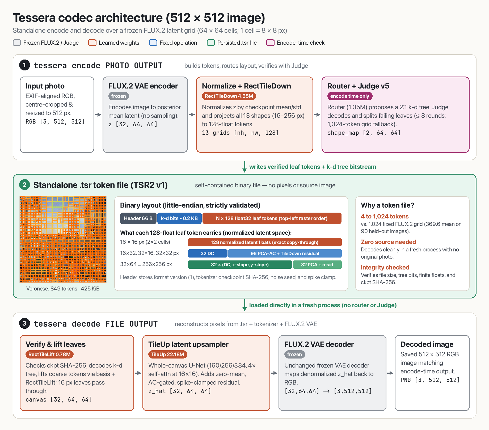
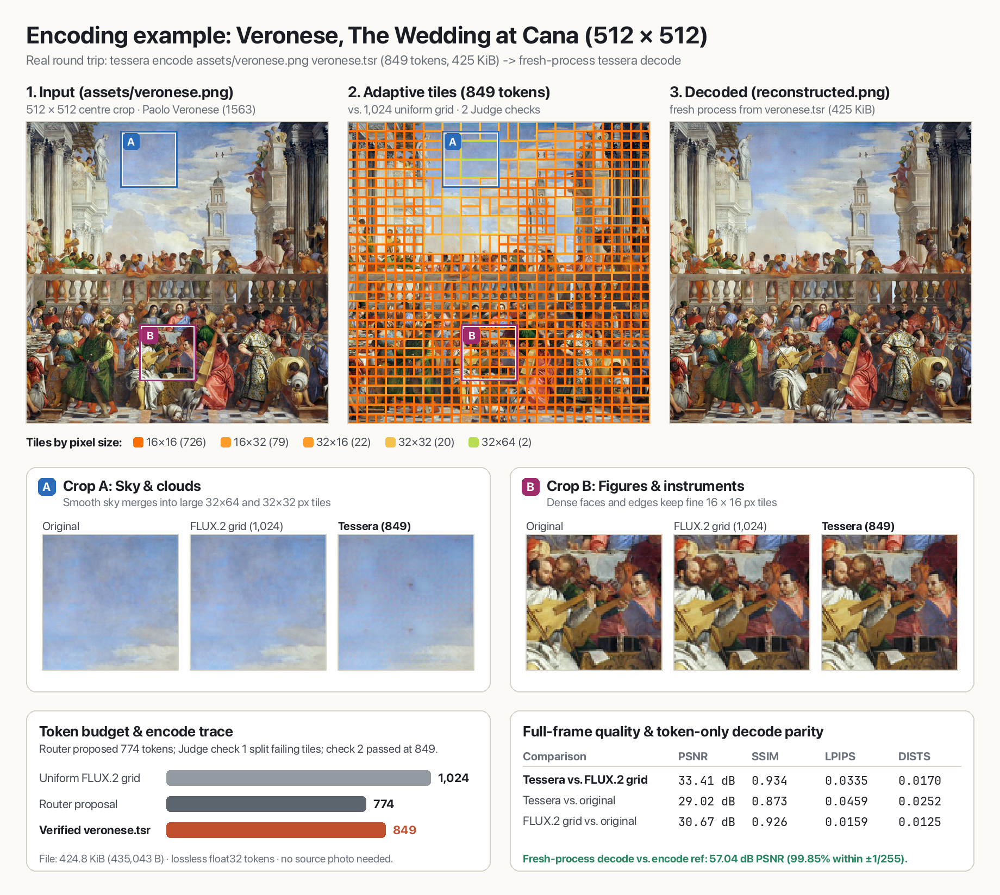

# Tessera

Tessera is a content-adaptive image tokenizer over FLUX.2 latent space. For 512 × 512 images, it replaces the uniform 1,024-token grid with adaptive rectangular tiles, emitting one 128-float token per leaf. Across 90 held-out images, Tessera averaged **369.6 tokens** and **2.9 Judge checks** per image, with **90/90** passing verification and zero full-grid fallbacks.

[Interactive demo](https://artifacts.kelechi.cc/tessera_demo_v2/)

## Quickstart

Requires Python 3.11+. Install locally and run on `assets/veronese.png`:

```bash
pip install .
tessera encode assets/veronese.png veronese.tsr
tessera decode veronese.tsr reconstructed.png
```

On first use, `tessera` automatically downloads the public tokenizer, router, and Apache-2.0 FLUX.2 VAE from [`tensorkelechi/tessera-checkpoints`](https://huggingface.co/tensorkelechi/tessera-checkpoints), and reuses the local Hugging Face cache offline.

## Architecture

A dilated convolutional router proposes a 2:1 k-d tree of rectangular tiles over the FLUX.2 latent grid. An encode-time perceptual Judge checks reconstruction quality against a plain FLUX.2 round trip, splitting failing tiles before saving standalone `.tsr` tokens that decode back to RGB.




