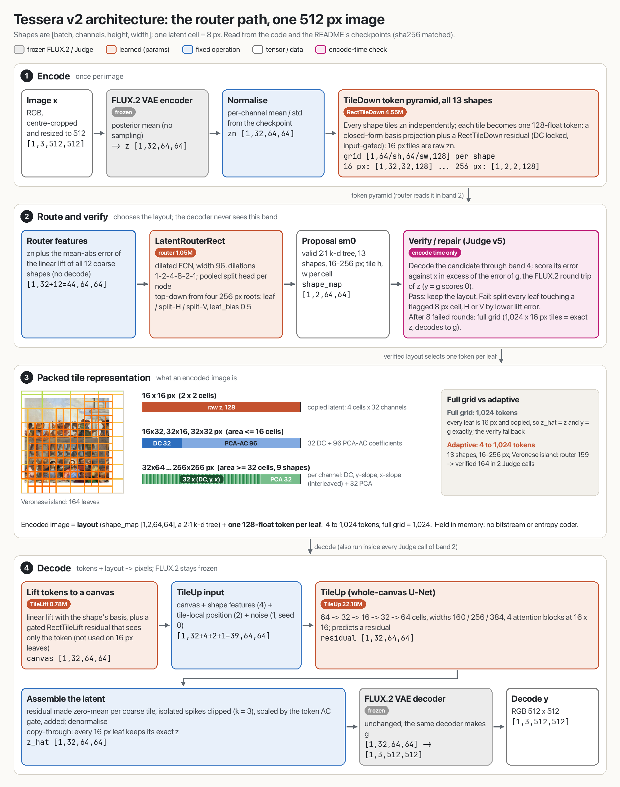

# Tessera

Tessera encodes a 512 × 512 image as a variable number of adaptive rectangular tiles on the FLUX.2 latent, using 128-float tokens instead of the uniform 1,024-token grid baseline. On 90 held-out images, the verified router averaged **369.6 tokens** and **2.9 Judge checks** per image, with all 90 passing without falling back to the full grid. Token counts adapt to content: **61 vs 1,021 tokens** for a clean Mondrian vs Where's Waldo at 512 px, and an **8.5× → 23.5×** Mondrian-vs-Waldo gap at matched sizes across a 512-block resolution ladder (512 to 4096 px).

[Interactive demo](https://artifacts.kelechi.cc/tessera_demo_v2/) · [Article](https://artifacts.kelechi.cc/articles/tessera-content-adaptive-tokenization) · [Lab report](https://artifacts.kelechi.cc/articles/tessera-v2-lab-report)

## How it works

The frozen FLUX.2 encoder maps the image to a 64 × 64 × 32 latent grid, TileDown computes candidate tile features, and the router proposes a rectangular leaf partition. TileLift, TileUp, and the frozen FLUX.2 decoder reconstruct pixels, which the Judge scores for *excess* error over the plain FLUX.2 round trip and splits failing leaves until the decode passes.



For a 192 × 192 Veronese painting patch on a white 512 × 512 canvas, the router proposed 159 tiles and 2 Judge checks produced a passing layout of **164 tokens** (6.2× fewer than the 1,024-token grid).


## Install

```bash
git clone https://github.com/kelechi-c/tessera && cd tessera
pip install .            # Python >= 3.11; installs the CUDA build of torch from PyPI - for CPU only, install torch first from
                         # https://download.pytorch.org/whl/cpu
```

## Weights and access

| what | where | sha256 |
| --- | --- | --- |
| tokenizer checkpoint (TileUp + TileDown + TileLift + basis + latent statistics, 121 MB) | `tensorkelechi/tessera-checkpoints`, `phase3_large_tl/step_20000.pt` | `6b092cfc9806424f6353f8141882a49715aedb2186bbccc3f9e9dd8438a5673d` |
| router (inference weights and config only, 4.2 MB) | `tensorkelechi/tessera-checkpoints`, `router/router_rect.pt` | `64885f0fcae11445ec531260626a291689cea7c3e748e3c0b88a1504ff7e9e93` |
| FLUX.2 VAE | `black-forest-labs/FLUX.2-dev` (`vae/` only is used) | gated: accept the licence on the model page with the same account |
| LPIPS and DISTS weights | downloaded on first use by the `lpips` and `DISTS-pytorch` packages | open |

`tensorkelechi/tessera-checkpoints` is **private**: ask the repository owner for read access, then `hf auth login` (or `export HF_TOKEN=...`).

```bash
hf download tensorkelechi/tessera-checkpoints phase3_large_tl/step_20000.pt router/router_rect.pt --local-dir weights
sha256sum weights/phase3_large_tl/step_20000.pt weights/router/router_rect.pt        # must match the table
```

The tokenizer checkpoint uses `torch.load(weights_only=False)` (verify its sha256 first); the router uses `weights_only=True`.

## Quickstart

Generates a synthetic 512 × 512 Mondrian and runs the flagship verified-router settings (~1.5–4 min on 8 CPU cores):

```bash
python - <<'PY'
from PIL import Image, ImageDraw
im = Image.new("RGB", (512, 512), (245, 243, 235)); d = ImageDraw.Draw(im)
for box, c in [((0, 0, 170, 200), (200, 30, 30)), ((170, 0, 512, 60), (20, 40, 150)), ((300, 60, 512, 300), (240, 200, 20)),
               ((300, 300, 512, 512), (20, 40, 150))]:
    d.rectangle(box, fill=c)
for x in (170, 300): d.line((x, 0, x, 512), fill=(10, 10, 10), width=6)
for y in (60, 200, 300): d.line((0, y, 512, y), fill=(10, 10, 10), width=6)
import os; os.makedirs("images", exist_ok=True); im.save("images/mondrian.png")
PY

tessera out --images images --ckpt weights/phase3_large_tl/step_20000.pt \
  --mode router --router weights/router/router_rect.pt --leaf_bias 0.5 \
  --judge_scale 1.0 --struct_scale 1.5 --color_floor_de 1.0 --color_max_floor_de 1.8 --tu_spike_k 3
```

Expected (CPU; the CUDA path is untested in this release):

```
[tessera] dev=cpu n=1 mode=router TileUp=22.18M RectTileDown=4.55M RectTileLift=0.78M
  [1/1] mondrian tok=102 pass=True calls=4 <time>ms
[tessera] 1/1 pass the Judge, mean 102.0 tokens -> out/results.json
```

Outputs are written to `out/results.json` (token counts, `judge_calls`, and PSNR/SSIM/LPIPS/DISTS) and `out/strips/*.png`.

## Options

`tessera OUT --images DIR --ckpt PATH [options]` — run `tessera --help` for the full list.

- `--mode`: `topdown` (default, no router), `router` (with `--router` and `--leaf_bias`), or `rdtree`.
- `--verify` / `--no_verify`, `--verify_rounds 8`: split failing leaves up to N rounds before falling back to 16 px tiles.
- `--prune_merges`: merge sibling leaves after a pass while the Judge still passes (fewer tokens, more Judge calls).
- `--judge_scale 3.0`: global tolerance multiplier; flagship strictness adds `--struct_scale`, `--color_floor_de`, `--color_max_floor_de`, and `--tu_spike_k`.
- `--save_layouts`: save per-cell `shape_map` arrays alongside images.

## Higher resolutions (512-block encodes)

Measured by running the 512 px CLI independently on each 512 × 512 block (369/369 blocks passed, 0 fallbacks). Tokens (compression vs blockwise FLUX grid):

| image class | 512 | 1024 | 2048 | 4096 |
|---|---|---|---|---|
| FLUX grid tokens | 1,024 | 4,096 | 16,384 | 65,536 |
| smooth sky (synthetic) | 69 (14.8x) | 102 (40.2x) | 270 (60.7x) | 825 (79.4x) |
| clean Mondrian (synthetic) | 120 (8.5x) | 295 (13.9x) | 837 (19.6x) | 2,253 (29.1x) |
| text slide | 368 (2.8x) | 980 (4.2x) | 2,057 (8.0x) | 4,283 (15.3x) |
| dense painting | 629 (1.6x) | 2,431 (1.7x) | 10,309 (1.6x) | 26,537 (1.5x) |
| Where's Waldo (4K page) | 1,023 (1.0x) | 4,065 (1.0x) | 15,783 (1.0x) | 30,904 (1.1x) |

Painting and Waldo 4096 rungs are 4096 × 2560 and 4096 × 2048; at matched sizes, Mondrian takes 120–1,317 tokens vs Waldo's 1,023–30,904 (8.5× → 23.5×).

## Limits

- **512-px CLI**: other input sizes are centre-cropped and resized to 512 × 512.
- **Higher-res is blockwise with seams**: independent 512 × 512 blocks have no cross-block context, adding ~0.2–2 levels of border step error.
- **Encode needs the Judge and real decoder**: encoding decodes pixels to score excess error over the FLUX.2 round trip and does not export a serialized token stream.
- **Router alone rarely passes without `--verify`**: on 45 calibration images, the pilot router passed only 0–4.4% unverified; verification repairs layouts in ~2.9 Judge checks.
- **CPU is slow**: each Judge check decodes 512 px and runs LPIPS/DISTS (minutes per image on CPU); use a GPU for batches.
- **Package scope**: training code, datasets, and full evaluation write-ups live outside this repo (see the [Article](https://artifacts.kelechi.cc/articles/tessera-content-adaptive-tokenization) and [Lab report](https://artifacts.kelechi.cc/articles/tessera-v2-lab-report)).
