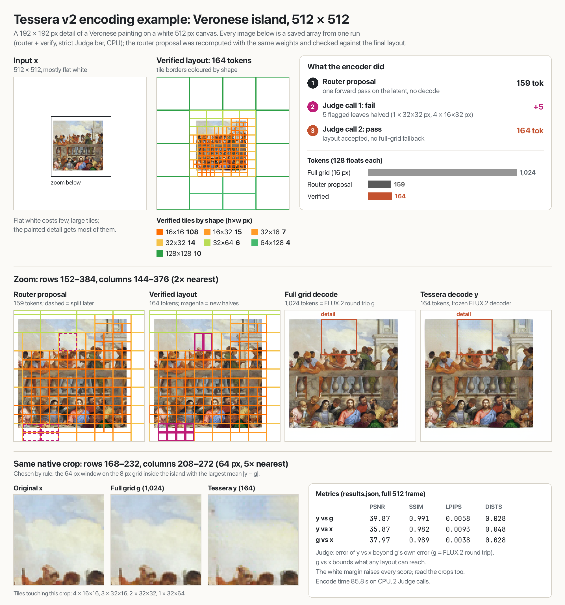

# Tessera

Tessera encodes a 512 × 512 image as a variable number of rectangular latent tokens. Each token holds 128 values. A uniform FLUX.2 grid uses 1,024 tokens at this resolution. On 90 held-out images, the verified router averaged 369.6 tokens and 2.9 Judge checks per image. All 90 passed without falling back to the full grid.

[Interactive demo](https://artifacts.kelechi.cc/tessera_demo_v2/) · [Article](https://artifacts.kelechi.cc/articles/tessera-content-adaptive-tokenization) · [Lab report](https://artifacts.kelechi.cc/articles/tessera-v2-lab-report)

## Architecture

The frozen FLUX.2 encoder maps the input to a 64 × 64 grid of 32-channel latent cells. TileDown computes candidate tile representations. The learned router proposes a rectangular partition across four roots, choosing where to keep a leaf or split it horizontally or vertically. Each selected leaf contributes one token.

TileLift and TileUp reconstruct a dense latent canvas from the selected tiles. The frozen FLUX.2 decoder turns that canvas into pixels. During encoding, the Judge checks the reconstruction against the ordinary FLUX.2 round trip, using the original as a reference. When a region fails, verification splits the affected leaves and decodes the revised layout. The CLI reports actual Judge evaluations in `judge_calls`.


## An encoding example

A 192 × 192 patch from a Veronese painting occupies 14% of a white 512 × 512 canvas. The router proposed **159 tiles**. After two Judge checks, the accepted layout used **164 tokens**, about **6.2× fewer** than the uniform grid. Reversing the example, with a white patch in the full painting, took 756 tokens. The full painting took 849. These counts describe layout leaves; the CLI does not measure compressed file size.



## Install

```bash
git clone https://github.com/kelechi-c/tessera && cd tessera
pip install .            # Python >= 3.11; installs the CUDA build of torch from PyPI - for CPU only, install torch first from
                         # https://download.pytorch.org/whl/cpu
```

## Weights and access

| what | where | sha256 |
| --- | --- | --- |
| tokenizer checkpoint (TileUp + TileDown + TileLift + basis + latent statistics, 121 MB) | `tensorkelechi/tessera-checkpoints`, `phase3_large_tl/step_20000.pt` | `6b092cfc9806424f6353f8141882a49715aedb2186bbccc3f9e9dd8438a5673d` |
| router (inference weights and config only, 4.2 MB) | `tensorkelechi/tessera-checkpoints`, `router/router_rect.pt` | `64885f0fcae11445ec531260626a291689cea7c3e748e3c0b88a1504ff7e9e93` |
| FLUX.2 VAE | `black-forest-labs/FLUX.2-dev` (`vae/` only is used) | gated: accept the licence on the model page with the same account |
| LPIPS and DISTS weights | downloaded on first use by the `lpips` and `DISTS-pytorch` packages | open |

`tensorkelechi/tessera-checkpoints` is **private**: ask the repository owner for read access, then `hf auth login` (or `export HF_TOKEN=...`).

```bash
hf download tensorkelechi/tessera-checkpoints phase3_large_tl/step_20000.pt router/router_rect.pt --local-dir weights
sha256sum weights/phase3_large_tl/step_20000.pt weights/router/router_rect.pt        # must match the table
```

The tokenizer checkpoint is a pickled `torch.load(weights_only=False)` file: load only a file whose hash you have checked.  The router
file holds tensors and plain numbers only and is loaded with `weights_only=True`.

## Run a reproducible example

This command creates a synthetic test image and runs the same verified-router settings as the demo.

```bash
python - <<'PY'
from PIL import Image, ImageDraw
im = Image.new("RGB", (512, 512), (245, 243, 235)); d = ImageDraw.Draw(im)
for box, c in [((0, 0, 170, 200), (200, 30, 30)), ((170, 0, 512, 60), (20, 40, 150)), ((300, 60, 512, 300), (240, 200, 20)),
               ((300, 300, 512, 512), (20, 40, 150))]:
    d.rectangle(box, fill=c)
for x in (170, 300): d.line((x, 0, x, 512), fill=(10, 10, 10), width=6)
for y in (60, 200, 300): d.line((0, y, 512, y), fill=(10, 10, 10), width=6)
import os; os.makedirs("images", exist_ok=True); im.save("images/mondrian.png")
PY

tessera out --images images --ckpt weights/phase3_large_tl/step_20000.pt \
  --mode router --router weights/router/router_rect.pt --leaf_bias 0.5 \
  --judge_scale 1.0 --struct_scale 1.5 --color_floor_de 1.0 --color_max_floor_de 1.8 --tu_spike_k 3
```

Expected (CPU; the CUDA path is untested in this release):

```
[tessera] dev=cpu n=1 mode=router TileUp=22.18M RectTileDown=4.55M RectTileLift=0.78M
  [1/1] mondrian tok=102 pass=True calls=4 <time>ms
[tessera] 1/1 pass the Judge, mean 102.0 tokens -> out/results.json
```

The 512 x 512 image costs 102 tokens: the router proposed 72, verification needed 4 Judge calls to reach a passing layout.  `results.json`
reports PSNR 36.78 dB against the FLUX.2 round trip and 34.97 dB against the original (the round trip itself is 41.15 dB from the original).
It takes about 1.5-4 minutes on 8 CPU cores.

`out/results.json` has, per image, the token count, Judge verdict, verification rounds (`calls`), actual Judge evaluations (`judge_calls` in router mode; `route_tok` is the router's layout
before verification) and PSNR / SSIM / LPIPS / DISTS of the decode against the FLUX.2 round trip (`tg`), against the original (`to`) and of the
round trip against the original (`go`).  `out/strips/*.png` shows original | decode | tile borders (colour = tile shape).
`--save_layouts` also writes each layout (`shape_map` uint8 [2, 64, 64]: tile height and width in cells at every cell), the original, the
decode and the round trip.

On 24 images of the project's final evaluation set (GPU run, same flags, same router), all 24 passed the Judge with a mean of 384 tokens and
2.7 Judge calls per image; the router's own layouts averaged 328 tokens before verification.  A plain FLUX.2 latent is 1,024 tokens.

## Options

`tessera OUT --images DIR --ckpt PATH [options]` (`tessera --help` lists all; defaults shown; the defaults are the Judge's default tolerance
`--judge_scale 3.0` and `topdown`, so the flagship flags above are given explicitly).

- `--mode router`: the learned router (`--router`, `--leaf_bias`) predicts the layout, then `--verify` (default on, `--verify_rounds 8`) splits
  failing leaves, falling back to all 16 px tiles if rounds run out; `--no_verify` returns the router's layout and reports whether it passes.
  `--mode topdown` (the default mode, no router needed): start from the four 32 x 32 cell roots and split every leaf the Judge flags until
  the decode passes (about 15x more Judge calls).  `--mode rdtree`: one-shot rate-distortion tree (`--rd_lambda 0.05 --rd_beta 0.5`), same verification.
- `--prune_merges`: after a pass, merge sibling leaves while the Judge still passes (`--prune_max_calls 48` Judge calls per image,
  `--prune_max_rounds 8`, `--prune_fast` skips bisecting failing chunks).  Fewer tokens, more Judge calls.
- `--judge_scale 3.0`: tolerance multiplier of every Judge gate (lower is stricter).  Stricter variants, all off by default:
  `--struct_scale`, `--color_floor_de`, `--color_max_floor_de`, `--mae32_limit`; `--tu_spike_k` clips isolated TileUp spikes.
  The strict bar of the flagship example is `--judge_scale 1.0 --struct_scale 1.5 --color_floor_de 1.0 --color_max_floor_de 1.8 --tu_spike_k 3`.

## Limits

- 512 px only: other sizes are centre-cropped and resized to 512 x 512.
- Tile vectors are used in memory. `results.json` records counts and quality metrics. The CLI reconstructs pixels during encoding and does not export a serialized token stream.
- A CPU run takes minutes per image (each Judge call decodes a 512 px image and runs LPIPS-VGG / DISTS); use a GPU for more than a few images.
- The Judge passes a layout when the decode matches the *FLUX.2 round trip*, not the original: the `go` metrics report the grid’s own reconstruction error against the source. A Judge pass indicates that the configured thresholds were met.  Fine text and photographed paintings keep many tokens.
- The router is a pilot trained on 279 labelled images (27 for validation).  Alone it is not usable: on 45 calibration images its layouts passed the
  Judge on 4.4 % (`--leaf_bias 0`) and 0 % (`0.5`) of images.  The result above is router + verification: verification repairs the layout with
  about 2-3 Judge calls instead of about 40 for `topdown` + pruning, at about the same token count.  Without `--verify` expect mostly failures.
  One-shot `rdtree` layouts passed 0-76 % depending on the setting.
- Flagship layouts are not pruned (`--prune_merges` would lower the token count at the cost of many more Judge calls).
- Training code, datasets and the evaluation write-ups are not part of this package.
